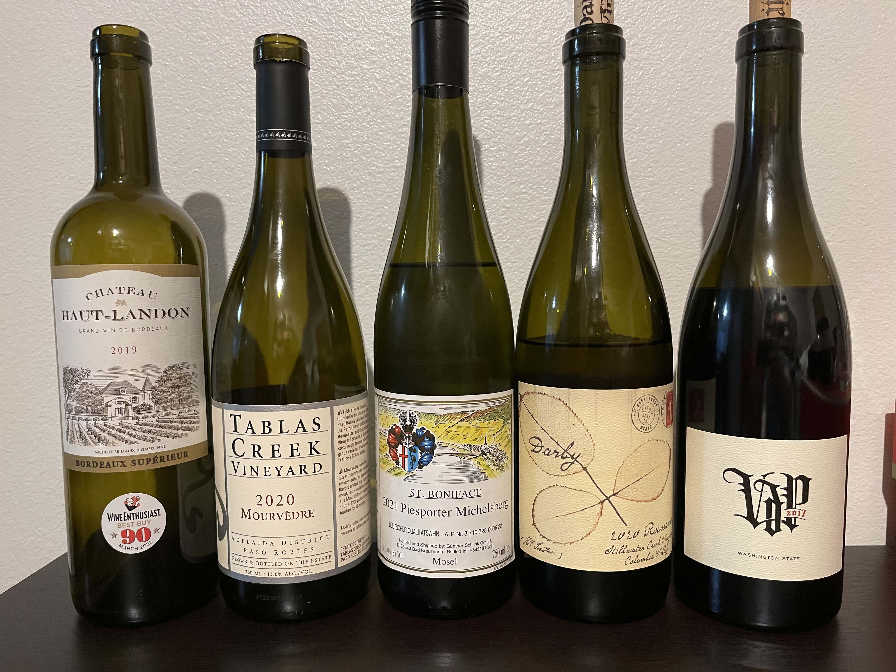

I went to an excellent wine tasting party last weekend, but, alas, I did not take any detailed notes. Here are some wines I enjoyed at home over the last week or so, and some vaguely WSET-style tasting notes for them.

## 2021 St Boniface Piesporter Michelsberg
Pale yellow. Medium+ aromatic intensity. Lime, petrol, peach, honey, wet stones, yellow apple. Medium Sweet. Low alcohol. Medium body. Medium+ acid. Medium+ intensity. Medium- finish. Sugary sweet mid-palate that leads to a tart, bitter finish. Flavors are pretty simple. 87 points.

## 2020 Tablas Creek Mourvèdre
I opened this because it has the dubious (in multiple senses) honor among my bottles of having the lowest community rating on CellarTracker. At the time of writing, it sat with both “0% like it” and a 50 point score. The sample size is extremely small, and Tablas Creek is a quality producer, so I was quite skeeptical. I’ve never given a score to a wine on CellarTracker, but this seemed like the time to start.
The wine pours a pale purplish red. It’s translucent and you can read through it, but it is more deeply colored than a rosé. Medium aromatic intensity. Licorice, violets, cured meat, tart cherries, raspberry, cranberry, thyme. Dry. Medium acid. Medium alcohol. Medium body. Medium, fine-grained tannin. Medium+ intensity. Most of the aromas reappear on the palate, but with a lot more juicy red fruit. Medium finish. 
Not the most complex Mourvèdre I’ve ever had, but this wine clearly deserves much better than its current 50 point score. I give it a solid 89.

## 2019 Château Haut-Landon Bordeaux Supérieur
This needed lots of time and air to open up. Medium ruby with a slight purple tint. Medium- aromatic intensity. Cedar, vanilla, leather, tobacco, raspberry, red plum, graphite. Dry. Medium alcohol. High tannin. Medium+ acid. Medium body. On the palate, the leather and cedar notes tend to dominate the fruit. Short finish. Drinkable but not great. 85 points

## 2020 Darby Roussanne Stillwater Creek Vineyard
Pale gold. Medium+ aromatic intensity. Pineapple, mango, honey, peach, vanilla, lemon, white blossoms, coconut. Dry. Medium+ acid. Medium+ body. High alcohol. It’s quite hot; the alcohol feels a bit out of balance. Medium+ body. More lemon and peach on the palate. Medium finish. 88 points.

## 2017 Rotie Cellars VdP
Deep ruby. Medium aromatic intensity. Olive, raspberry, black cherry, cured meat, thyme, black pepper. Dry. Medium acid. Medium+ body. High alcohol. Medium, chalky tannin. Medium+ intensity. Less savory and more fruity on the palate. Medium finish. 89 points.
