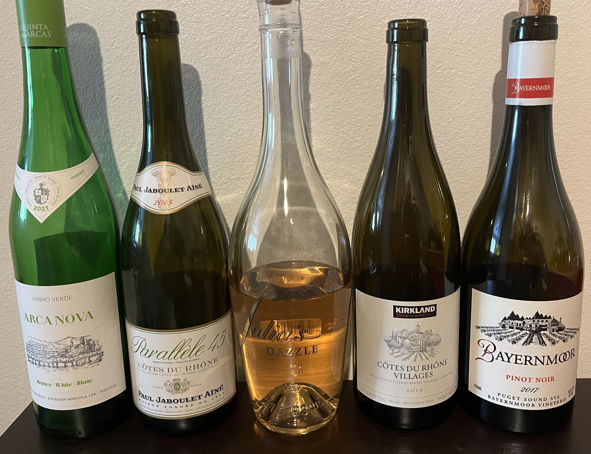

Here are some wines I enjoyed at home over the last week or so, and some vaguely WSET-style tasting notes for them.

## 2021 Quinta das Arcas Arca Nova Vinho Verde
Pale lemon. Medium aromatic intensity. Lemon, green apple, wet stones. Dry. Slight effervescence. Medium- body. Low alcohol. High acid. Medium intensity. Pretty simple green apple and lemon on the palate. Medium finish. Pairs well with sunshine. 87 points.

## 2015 Paul Jaboulet Aîné Parallèle 45 Côtes du Rhône Blanc
Medium gold. Medium aromatic intensity. Hay, lemon, almonds. Dry. Medium body. Medium alcohol. Medium acid. Medium intensity. Not much fruit left on the palate: maybe a hint of lemon and peach. This really is past its prime, but the tertiary notes keep it interesting. No score.

## 2019 Kirkland Signature Cotes du Rhone Villages
Medium ruby. Medium aromatic intensity. Red cherry, raspberry, thyme, cured meat, leather, blackberry. Dry. High alcohol. Medium+ body. Medium coarse tannin. Medium+ intensity. Fruit has a candied, jammy quality on the palate. Probably from the high alcohol. 88 points.

## 2022 Julia’s Dazzle
Pale orange-pink. Medium- aromatic intensity. Peach, blossom, orange zest, oyster shell. Dry. High acid. Medium alcohol. Medium- body. Medium+ intensity. Flavors on the palate mirror the nose but with an additional brioche note. Medium finish. 90 points.

## 2017 Bayernmoor Cellars Estate Pinot Noir
Pale ruby with an orange-ish rim. Medium+ aromatic intensity. Cranberry, raspberry, black tea, mushroom, forest floor, red cherry. Dry. High acid. Medium alcohol. Medium body. Medium chalky tannin. Medium intensity. Medium finish. Juicy, high acid, fresh with tertiary development. 89 points.
